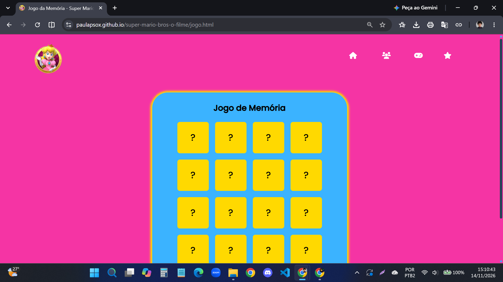
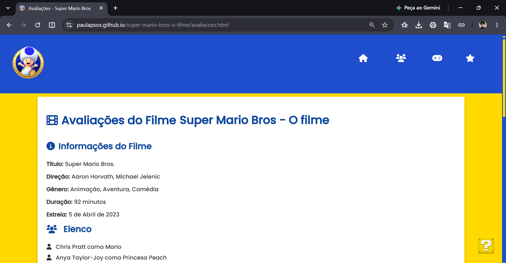

 <div align="center">

  <!-- STATUS E INFORMAÇÕES DO REPOSITÓRIO -->

  
  
  

  <br>

  # 🍄 Super Mario Bros. — O Filme

  ### Interactive Web Experience

  **Uma experiência interativa que combina desenvolvimento front-end, elementos multimídia e lógica de programação em JavaScript.**

  Desenvolvido com HTML5 semântico, CSS3 modular e JavaScript Vanilla, explorando recursos nativos do navegador para criar uma aplicação temática com diferentes experiências de interação.

  <br>

  <a href="https://paulapsox.github.io/super-mario-bros-o-filme/index.html">
    
  </a>
  <a href="https://github.com/paulaPSOx/super-mario-bros-o-filme">
    
  </a>

  <br><br>

  

  <br><br>

  

</div>

---

## 📌 Índice

- [Visão Geral](#-visão-geral)
- [Objetivos Técnicos](#-objetivos-técnicos)
- [Funcionalidades](#-funcionalidades)
- [Destaques de Engenharia](#-destaques-de-engenharia)
- [Soluções Técnicas](#-soluções-técnicas)
- [Demonstração Visual](#-demonstração-visual)
- [Tecnologias e Recursos](#️-tecnologias-e-recursos)
- [Execução Local](#️-execução-local)
- [Arquitetura de Diretórios](#-arquitetura-de-diretórios)
- [Organização do Código](#-organização-do-código)
- [Aprendizados](#-aprendizados)
- [Testes e Validações](#-testes-e-validações)
- [Roadmap](#-roadmap-de-evolução)
- [Licença](#-licença-e-propriedade-intelectual)
- [Autora](#-autora)

---

## 📖 Visão Geral

O **Super Mario Bros. — O Filme** é uma aplicação front-end temática inspirada no universo de Super Mario. O projeto reúne diferentes páginas e funcionalidades interativas em uma experiência desenvolvida inteiramente no lado do cliente (*client-side*).

A proposta foi explorar recursos fundamentais do desenvolvimento web, integrando estruturação semântica, estilização, manipulação do DOM, eventos JavaScript e elementos multimídia.

A aplicação está organizada em quatro módulos:

1. **Página Inicial:** apresentação visual com vídeo de fundo, navegação, modal para exibição do trailer e interação com um bloco de moedas.

2. **Galeria de Personagens:** apresentação de oito personagens com reprodução de efeitos sonoros acionados por eventos de clique.

3. **Jogo da Memória:** jogo com 16 cartas, oito pares, embaralhamento inicial, identificação de combinações e controle das jogadas.

4. **Sistema de Avaliações:** formulário interativo com seleção de estrelas, validação de informações e exibição dinâmica dos comentários enviados.

O projeto foi desenvolvido como parte de um desafio da comunidade **[Dev Em Dobro](https://github.com/devemdobro)** e da **Guild Dev Em Dobro**.

> 💡 **Diferencial:** a aplicação integra diferentes experiências em páginas independentes, utilizando JavaScript para controlar interações, elementos dinâmicos, reprodução de áudio e lógica de jogo, sem depender de frameworks JavaScript.

## 🎯 Objetivos Técnicos

- Aplicar conceitos de HTML5 na estruturação de páginas e elementos multimídia.
- Desenvolver interfaces com CSS3, utilizando Flexbox, Grid, animações e Media Queries.
- Praticar JavaScript Vanilla na manipulação do DOM e no gerenciamento de eventos.
- Implementar lógica de comparação e controle de jogadas em um jogo da memória.
- Trabalhar com reprodução de áudio e vídeo utilizando recursos nativos do navegador.
- Organizar estilos e scripts em arquivos separados por responsabilidade.
- Explorar validações de formulários e atualização dinâmica de conteúdo.
- Desenvolver uma interface visualmente consistente e adaptável a diferentes telas.

## ✨ Funcionalidades

| Módulo | Funcionalidade | Descrição |
|---|---|---|
| 🏠 Home | Apresentação | Página inicial com vídeo de fundo e navegação entre módulos. |
| 🎬 Trailer | Modal de vídeo | Abertura e fechamento de modal para exibição do trailer. |
| 🪙 Interação | Bloco de moedas | Animação de moeda acompanhada de efeito sonoro. |
| 👥 Personagens | Galeria interativa | Apresentação de oito personagens com sons individuais. |
| 🧠 Jogo | Jogo da memória | 16 cartas organizadas em oito pares. |
| 🎮 Jogo | Verificação de pares | Comparação das cartas selecionadas e controle de jogadas. |
| 🔊 Jogo | Feedback sonoro | Sons específicos para acertos, erros, vitória e reinício. |
| ⭐ Avaliações | Sistema de estrelas | Seleção de notas de uma a cinco estrelas. |
| 💬 Avaliações | Formulário interativo | Validação de nome, comentário e nota selecionada. |
| 📝 Avaliações | Comentários dinâmicos | Exibição de novas avaliações sem recarregar a página. |

## ⚙️ Destaques de Engenharia

### 1. JavaScript Vanilla e manipulação do DOM

A aplicação utiliza JavaScript sem frameworks para controlar os elementos da interface, registrar eventos, modificar classes CSS e criar componentes dinamicamente.

### 2. Controle de interação no jogo da memória

O jogo utiliza variáveis de controle para acompanhar as cartas selecionadas e impedir novas jogadas enquanto duas cartas estão sendo verificadas.

A comparação dos pares utiliza o atributo `data-name` e a propriedade `dataset` dos elementos HTML.

### 3. Reprodução e controle de áudio

Os efeitos sonoros são reproduzidos por meio da API nativa `Audio` do navegador.

Em interações específicas, a propriedade `currentTime` é utilizada para reiniciar a reprodução do áudio antes de executá-lo novamente.

### 4. CSS modular

Os estilos estão separados por contexto funcional, permitindo que cada página tenha suas próprias regras de apresentação.

Essa organização facilita a identificação de estilos, a manutenção e a evolução da interface.

### 5. Renderização dinâmica de avaliações

Os comentários são criados por meio de elementos HTML gerados com JavaScript e adicionados dinamicamente ao DOM.

O sistema também atualiza visualmente a classificação por estrelas e valida os campos antes de exibir uma avaliação.

## 🧠 Soluções Técnicas

| Desafio técnico | Solução implementada | Resultado |
|---|---|---|
| Controle das cartas | Variáveis de estado e bloqueio temporário do tabuleiro. | Evita selecionar novas cartas enquanto um par está sendo verificado. |
| Identificação de combinações | Comparação dos atributos `data-name` por meio de `dataset`. | Permite identificar cartas correspondentes. |
| Distribuição das cartas | Alteração da propriedade CSS `order` com posições aleatórias. | Cria diferentes disposições das cartas no início da partida. |
| Reprodução de áudio | Utilização de `Audio`, `play()` e `currentTime`. | Permite reproduzir efeitos sonoros durante as interações. |
| Avaliação por estrelas | Eventos de clique e mouse para atualizar classes CSS. | Apresenta visualmente a nota selecionada. |
| Inclusão de comentários | Criação de elementos com `document.createElement()` e inserção no DOM. | Atualiza a lista de comentários sem recarregar a página. |
| Interação com o bloco | Manipulação de classes, visibilidade e temporização. | Produz a animação da moeda acompanhada de áudio. |

## 🖥️ Demonstração Visual

Confira as principais interfaces da aplicação:

<details open>
<summary><strong>🍄 Visualizar as telas do projeto</strong></summary>

<br>

<div align="center">

| Página Inicial | Galeria de Personagens |
|:---:|:---:|
|  |  |

| Jogo da Memória | Sistema de Avaliações |
|:---:|:---:|
|  |  |

</div>

</details>

## 🛠️ Tecnologias e Recursos

| Tecnologia / Recurso | Aplicação no projeto |
|---|---|
| **HTML5** | Estruturação das páginas, formulários e elementos multimídia. |
| **CSS3** | Layouts, Flexbox, Grid, Media Queries, animações e responsividade. |
| **JavaScript ES6+** | Manipulação do DOM, eventos, validações e lógica do jogo. |
| **HTML5 Audio** | Reprodução de efeitos sonoros. |
| **HTML5 Video** | Exibição de vídeo de fundo e conteúdo multimídia. |
| **Google Fonts** | Integração de fontes para a identidade visual. |
| **Font Awesome** | Ícones utilizados nos elementos da interface. |

### Ferramentas de desenvolvimento

- **Visual Studio Code:** ambiente de desenvolvimento.
- **Git:** controle de versão.
- **GitHub:** hospedagem do repositório.
- **GitHub Pages:** publicação da aplicação.

**Arquitetura:** aplicação estática executada no navegador, sem framework JavaScript, gerenciador de pacotes ou etapa de build.

## ⚡ Execução Local

### Pré-requisitos

- Git instalado.
- Navegador atualizado.
- Visual Studio Code (opcional).

### 1. Clone o repositório

```bash
git clone https://github.com/paulaPSOx/super-mario-bros-o-filme.git
```

### 2. Acesse o diretório

```bash
cd super-mario-bros-o-filme
```

### 3. Abra a aplicação

**Opção 1 — Navegador**

Abra o arquivo `index.html` diretamente no navegador.

**Opção 2 — Live Server**

No Visual Studio Code, utilize a extensão Live Server e selecione:

`Open with Live Server`

**Opção 3 — Servidor local com Python**

```bash
python -m http.server 3000
```

Acesse no navegador:

```text
http://localhost:3000
```

Não é necessário instalar dependências ou executar comandos de build.

## 📂 Arquitetura de Diretórios

```text
super-mario-bros-o-filme/
│
├── img-super-mario-bros/          # Capturas de tela e imagens da documentação
│   ├── img-inspiração.png
│   ├── super-mario-bros-home.png
│   ├── super-mario-bros-personagens.png
│   ├── super-mario-bros-jogo.png
│   └── super-mario-bros-avaliações.png
│
├── src/
│   │
│   ├── css/                       # Estilos organizados por página
│   │   ├── reset.css
│   │   ├── style.css
│   │   ├── personagens.css
│   │   ├── jogo.css
│   │   └── avaliacoes.css
│   │
│   ├── imagens/                   # Recursos gráficos e personagens
│   │
│   ├── js/                        # Scripts organizados por funcionalidade
│   │   ├── index.js
│   │   ├── personagens.js
│   │   ├── jogo.js
│   │   └── avaliacoes.js
│   │
│   ├── sounds/                    # Efeitos sonoros em MP3
│   │
│   └── video/                     # Vídeo utilizado na aplicação
│       └── video-mario.mp4
│
├── index.html                     # Página inicial
├── personagens.html               # Galeria de personagens
├── jogo.html                      # Jogo da memória
├── avaliacoes.html                # Sistema de avaliações
├── LICENSE                        # Licença do projeto
└── README.md                       # Documentação
```

## 🧩 Organização do Código

A organização dos arquivos segue a separação entre estrutura, apresentação e comportamento da aplicação.

| Arquivo | Responsabilidade |
|---|---|
| `index.html` | Estrutura da página inicial e apresentação do projeto. |
| `personagens.html` | Estrutura da galeria de personagens. |
| `jogo.html` | Estrutura do jogo da memória. |
| `avaliacoes.html` | Estrutura das informações do filme e formulário de avaliações. |
| `src/css/reset.css` | Padronização inicial dos estilos. |
| `src/css/style.css` | Estilização da página inicial. |
| `src/css/personagens.css` | Estilização da galeria de personagens. |
| `src/css/jogo.css` | Estilização do jogo da memória. |
| `src/css/avaliacoes.css` | Estilização da página de avaliações. |
| `src/js/index.js` | Controle do modal do trailer e interação com o bloco de moedas. |
| `src/js/personagens.js` | Eventos de clique e reprodução dos sons dos personagens. |
| `src/js/jogo.js` | Criação das cartas, embaralhamento, comparação de pares e reinício da partida. |
| `src/js/avaliacoes.js` | Seleção de estrelas, validação do formulário e exibição dinâmica dos comentários. |

## 📚 Aprendizados

O desenvolvimento deste projeto proporcionou a prática de diferentes conceitos importantes para o desenvolvimento front-end:

- **Manipulação do DOM:** seleção, criação e atualização de elementos HTML com JavaScript.
- **Eventos JavaScript:** utilização de `addEventListener()` para responder às interações do usuário.
- **Lógica de programação:** aplicação de condições, funções, variáveis de controle e comparação de dados.
- **Controle de interação:** gerenciamento das cartas selecionadas e do fluxo de jogadas.
- **Recursos multimídia:** integração e controle de áudio e vídeo no navegador.
- **CSS modular:** separação de estilos por página e responsabilidade.
- **Formulários:** validação de campos e atualização dinâmica das informações.
- **Responsividade:** utilização de recursos CSS para adaptação da interface a diferentes dimensões de tela.

## 🔍 Testes e Validações

Os seguintes cenários podem ser utilizados para validar o funcionamento da aplicação:

- [ ] Verificar o carregamento das páginas e dos recursos visuais.
- [ ] Navegar entre os quatro módulos da aplicação.
- [ ] Abrir e fechar o modal do trailer.
- [ ] Testar a animação e o áudio do bloco de moedas.
- [ ] Interagir com os oito personagens e seus efeitos sonoros.
- [ ] Verificar a identificação de pares no jogo da memória.
- [ ] Testar o bloqueio temporário do tabuleiro durante as jogadas.
- [ ] Verificar o funcionamento do botão de reinício.
- [ ] Testar o preenchimento e a validação do formulário.
- [ ] Verificar a atualização dinâmica dos comentários.
- [ ] Inspecionar o console do navegador.
- [ ] Verificar a apresentação em diferentes tamanhos de tela.

## 🚀 Roadmap de Evolução

Possíveis melhorias para futuras versões:

- [ ] **Persistência de dados:** utilizar LocalStorage para manter avaliações e informações entre sessões.
- [ ] **Métricas do jogo:** implementar cronômetro, contador de movimentos e recordes.
- [ ] **Níveis de dificuldade:** adicionar diferentes configurações de cartas.
- [ ] **Acessibilidade (A11y):** aprimorar a navegação por teclado e os atributos ARIA.
- [ ] **Experiência mobile:** aperfeiçoar interações e apresentação em dispositivos móveis.
- [ ] **Internacionalização (i18n):** adicionar suporte a outros idiomas.

## 📄 Licença e Propriedade Intelectual

Este projeto está disponibilizado sob a licença **MIT**.

Consulte o arquivo [LICENSE](./LICENSE) para conhecer os termos de utilização.

**Nota legal:** este é um projeto independente, desenvolvido para fins educacionais e de portfólio. Os personagens, nomes, marcas e elementos visuais relacionados a Super Mario Bros pertencem aos seus respectivos titulares. O projeto não possui vínculo oficial com a Nintendo ou com os produtores do filme.

## 🙌 Créditos

Projeto desenvolvido como parte de um desafio da comunidade **[Dev Em Dobro](https://github.com/devemdobro)** e da **Guild Dev Em Dobro**.

Agradeço à comunidade pelo conteúdo, pelas referências e pelo incentivo à prática e ao desenvolvimento de projetos.

---

## 👩🏻‍💻 Autora

<div align="center">

  <a href="https://github.com/paulaPSOx">
    
    <br>
    <strong>Paula Oliveira</strong>
  </a>

  <br>

  Desenvolvedora Front-end em formação

  <br><br>

  <a href="https://github.com/paulaPSOx">
    
  </a>
  <a href="https://linkedin.com/in/oliveiraspaula/">
    
  </a>

  <br><br>

  **Construindo, aprendendo e evoluindo a cada projeto. 🚀**

  <br>

  <sub>Se este projeto chamou sua atenção, considere deixar uma ⭐ no repositório!</sub>

</div>
