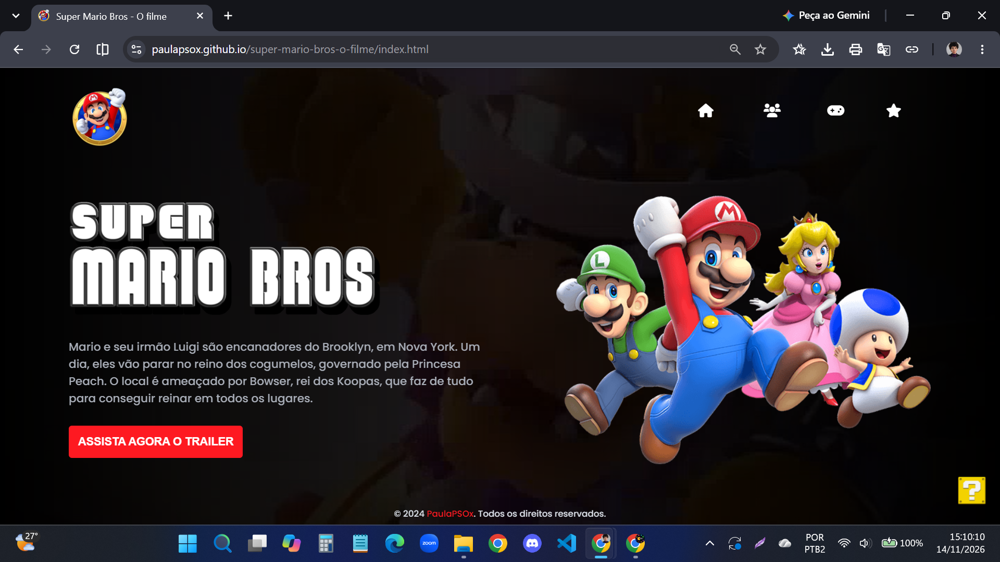
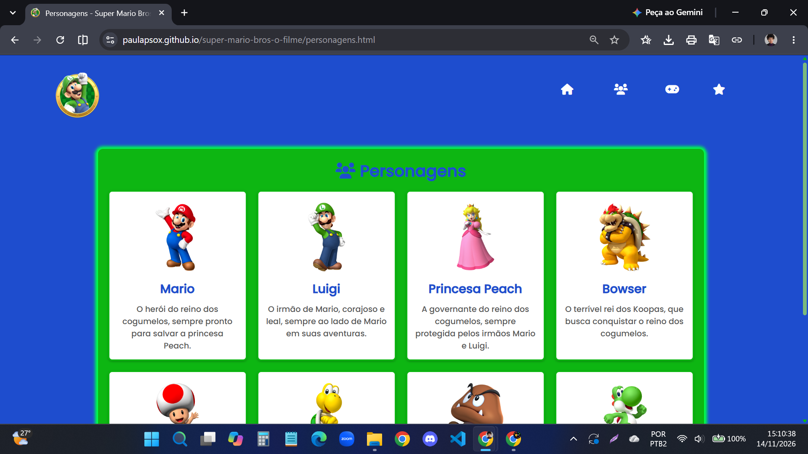

<div align="center">



<br><br>

# 🍄 SUPER MARIO BROS. — O FILME

**Um site temático em 4 fases: trailer, personagens sonoros, jogo da memória e avaliações.**<br>
HTML5 · CSS3 · JavaScript puro — sem frameworks JavaScript e sem etapa de build.

<p>
  
  
  
</p>

<p>
  <a href="https://paulapsox.github.io/super-mario-bros-o-filme/index.html">
    
  </a>
  <a href="https://github.com/paulaPSOx/super-mario-bros-o-filme">
    
  </a>
</p>

</div>

---

## ⚡ Em 30 segundos

| | |
| :-- | :-- |
| **O que é** | Site multipágina inspirado no filme *Super Mario Bros.*, feito do zero com tecnologias nativas da web. |
| **Para quê** | Praticar DOM, eventos, lógica de programação, multimídia e responsividade em um projeto completo e publicado. |
| **Destaque** | Jogo da memória com lógica própria (16 cartas, bloqueio de tabuleiro, efeitos sonoros) e formulário com validação. |
| **Stack** | HTML5, CSS3 (Flexbox, Grid e media queries), JavaScript (ES6+). |
| **Online** | [paulapsox.github.io/super-mario-bros-o-filme](https://paulapsox.github.io/super-mario-bros-o-filme/index.html) |

---

## 🎮 Conheça as 4 fases

<table>
  <tr>
    <td width="50%" valign="top">
      <a href="https://paulapsox.github.io/super-mario-bros-o-filme/index.html">
        
      </a>
      <p align="center"><strong>1 · Home</strong><br>Vídeo de fundo, sinopse e trailer em modal.</p>
    </td>
    <td width="50%" valign="top">
      <a href="https://paulapsox.github.io/super-mario-bros-o-filme/personagens.html">
        
      </a>
      <p align="center"><strong>2 · Personagens</strong><br>Oito personagens, cada um com seu som.</p>
    </td>
  </tr>
  <tr>
    <td width="50%" valign="top">
      <a href="https://paulapsox.github.io/super-mario-bros-o-filme/jogo.html">
        
      </a>
      <p align="center"><strong>3 · Jogo da memória</strong><br>16 cartas, 8 pares, tabuleiro embaralhado.</p>
    </td>
    <td width="50%" valign="top">
      <a href="https://paulapsox.github.io/super-mario-bros-o-filme/avaliacoes.html">
        
      </a>
      <p align="center"><strong>4 · Avaliações</strong><br>Estrelas, formulário e comentários ao vivo.</p>
    </td>
  </tr>
</table>

> 💡 **Dica para quem for testar:** clique no bloco do Mario (Home e Avaliações), clique nos personagens para ouvir cada som e tente zerar o jogo da memória.

---

## ⭐ Power-ups (funcionalidades)

### 🏠 Home
- Vídeo de fundo em loop e sem áudio.
- Modal com trailer incorporado do YouTube; ao fechar, o vídeo é interrompido.
- Bloco do Mario interativo: animação de moeda com efeito sonoro.

### 🎭 Personagens
- Mario, Luigi, Peach, Bowser, Toad, Koopa, Goomba e Yoshi, cada um com imagem, nome e descrição.
- Clique em um personagem para tocar o som dele.

### 🧠 Jogo da memória
- Tabuleiro gerado dinamicamente via JavaScript.
- 16 cartas (8 pares) em ordem aleatória a cada partida.
- Tabuleiro bloqueado durante a checagem de um par, evitando cliques extras.
- Cartas que formam par ficam desativadas.
- Sons diferentes para acerto, erro, vitória e reinício.

### ✍️ Avaliações
- Informações do filme: elenco, sinopse, recepção crítica, bilheteria e detalhes técnicos.
- Nota de 1 a 5 estrelas, com destaque ao passar o mouse e ao clicar.
- Validação do formulário: nome, comentário e nota são obrigatórios. O nome aceita até 30 caracteres e o comentário, até 50.
- Comentários exibidos na hora, do mais novo para o mais antigo, com efeito de entrada.

> **Observação:** não há backend. Os comentários existem apenas durante a sessão e somem ao recarregar a página.

---

## 🔧 Por dentro do código

Algumas decisões que tomei durante o desenvolvimento:

| Tema | Como foi resolvido |
| :-- | :-- |
| **Cartas do jogo** | Os pares vêm de um array de imagens e cada carta é criada com `createElement`. A posição de cada carta é sorteada com a propriedade CSS `order`. |
| **Controle de turno** | Variáveis de estado controlam a jogada (veja abaixo). Com o tabuleiro bloqueado, o jogador não vira uma terceira carta enquanto o par é verificado. |
| **Sons dos personagens** | Cada `<article>` guarda o caminho do áudio em `data-sound`. Um único laço em JavaScript registra o evento de clique, sem repetir código para cada personagem. |
| **Trailer** | A `src` do iframe é removida ao fechar o modal e restaurada ao abrir, o que interrompe o vídeo. |
| **Estrelas** | Os eventos `click`, `mouseover` e `mouseout` alternam classes CSS (`selected` e `hover`) para refletir a nota. |
| **Responsividade** | Cada página tem seu CSS com media queries, adaptando o layout de telas grandes até celulares pequenos (cerca de 340 px). Flexbox organiza os componentes e Grid monta as grades de personagens e de cartas. |

### 🎯 Destaque: a lógica do jogo da memória

| Variável | Papel na partida |
| :-- | :-- |
| `firstCard` | Primeira carta virada na jogada. |
| `secondCard` | Segunda carta virada na jogada. |
| `hasFlippedCard` | Indica se já existe uma primeira carta virada. |
| `lockBoard` | Impede novas jogadas enquanto o par está sendo verificado. |
| `matchCount` | Conta os pares encontrados; ao chegar a 8, o som de vitória toca. |

Em caso de erro, as cartas voltam ao verso depois de 1,5 segundo. Em caso de acerto, elas ficam desativadas.

---

## 🧱 Blocos de construção (tecnologias)

<table>
  <tr>
    <td align="center" width="33%">
      <br>
      <strong>HTML5</strong><br>
      <sub>Estrutura semântica das páginas.</sub>
    </td>
    <td align="center" width="33%">
      <br>
      <strong>CSS3</strong><br>
      <sub>Layout, animações e responsividade.</sub>
    </td>
    <td align="center" width="33%">
      <br>
      <strong>JavaScript</strong><br>
      <sub>Lógica, DOM, eventos e áudio.</sub>
    </td>
  </tr>
</table>

**Complementos:** [Font Awesome](https://fontawesome.com/) (ícones) · [Google Fonts](https://fonts.google.com/) (Open Sans, Poppins e Roboto) · [YouTube Embed](https://www.youtube.com/) (trailer) · [GitHub Pages](https://pages.github.com/) (hospedagem).

---

## 🗂️ Estrutura do projeto

```text
super-mario-bros-o-filme/
├── index.html            # Home
├── personagens.html      # Personagens
├── jogo.html             # Jogo da memória
├── avaliacoes.html       # Avaliações
├── img-super-mario-bros/ # Prints e imagem de referência
├── src/
│   ├── css/              # reset + um CSS por página
│   ├── js/               # um JS por página
│   ├── imagens/          # personagens, logos, bloco e moeda
│   ├── sounds/           # sons dos personagens e do jogo
│   └── video/            # vídeo de fundo da Home
├── LICENSE
└── README.md
```

Cada página tem o seu próprio CSS e o seu próprio JavaScript, com `reset.css` compartilhado, o que mantém cada arquivo com uma responsabilidade clara.

---

## 🚀 Como rodar

Não há dependências nem etapa de build. Escolha uma das opções:

**Opção 1 — Acessar online:** [abrir no GitHub Pages](https://paulapsox.github.io/super-mario-bros-o-filme/index.html).

**Opção 2 — Baixar o ZIP:** clique em **Code → Download ZIP** neste repositório, extraia e abra o `index.html` no navegador.

**Opção 3 — Clonar com Git:**

```bash
git clone https://github.com/paulaPSOx/super-mario-bros-o-filme.git
cd super-mario-bros-o-filme
```

Depois, abra o `index.html` no navegador. Se usar o VS Code, a extensão **Live Server** também funciona.

> Ícones, fontes e o trailer do YouTube dependem de internet. Mantenha as pastas `src/` no lugar original para imagens, sons e vídeo carregarem.

---

## 📚 O que este projeto me ensinou

- Estruturar páginas com HTML semântico e organizar arquivos por responsabilidade.
- Criar layouts com Flexbox e Grid e adaptá-los com media queries.
- Manipular o DOM: criar elementos, alternar classes e reagir a eventos.
- Controlar áudio e vídeo pelo JavaScript.
- Modelar o estado de um jogo e resolver problemas de lógica, como o bloqueio do tabuleiro.
- Validar formulários e dar feedback ao usuário.
- Publicar um projeto com GitHub Pages.

---

## 🏁 Próximas fases

Melhorias que quero fazer, e que **ainda não estão implementadas**:

- [ ] Sanitizar o conteúdo dos comentários (trocar `innerHTML` por `textContent`) para evitar injeção de HTML.
- [ ] Salvar as avaliações (`localStorage` como primeiro passo e, depois, um backend).
- [ ] Acessibilidade: navegação por teclado no jogo da memória e foco visível nos elementos interativos.
- [ ] Trocar o sorteio por `order` por um algoritmo de embaralhamento apropriado (Fisher–Yates).
- [ ] Reiniciar o jogo sem recarregar a página.
- [ ] Contador de jogadas e mensagem visual de vitória.
- [ ] Otimizar imagens, áudios e vídeo para carregar mais rápido.

---

## 🎨 Inspiração e créditos

O ponto de partida foi um layout de referência do desafio, com a estrutura semântica da página (`header`, `nav`, `main`, `div` e `img`) destacada em cores:


Projeto desenvolvido a partir de desafios práticos das comunidades [**Dev Em Dobro**](https://github.com/devemdobro) e **Guild Dev Em Dobro**. Obrigada pelo conteúdo e pela oportunidade de praticar.

---

## 📄 Licença e aviso

Código disponibilizado sob a licença **MIT**. Veja o arquivo [`LICENSE`](LICENSE).

Projeto independente, feito para estudo e portfólio. Não possui vínculo, patrocínio ou aprovação da Nintendo, da Illumination, da Universal Pictures ou de qualquer outra detentora de direitos do filme. Personagens, nomes, imagens, vídeos e sons pertencem aos seus respectivos titulares.

---

<div align="center">

## 👩‍💻 Feito por Paula Oliveira

Desenvolvedora full stack em formação, com foco atual em front-end.<br>
Este projeto marca uma etapa da minha evolução: da prática dos fundamentos à construção de algo completo, interativo e no ar.

<p>
  <a href="https://github.com/paulaPSOx">
    
  </a>
  <a href="https://www.linkedin.com/in/oliveiraspaula/">
    
  </a>
</p>

**Gostou? Deixe uma ⭐ no repositório. É o meu power-up favorito.** 🍄

</div>
